# 00 — Primeros pasos

## 0.1. Primer arranque

Al abrir la aplicación por primera vez, se comprueban las herramientas necesarias para compilar ROMs de Game Boy Advance. Si **devkitARM** no está instalado, aparece una ventana informándote y dándote dos opciones:

- **Instalar devkitPro** automáticamente (en Linux puede pedir tu contraseña del sistema).
- **Descargarlo manualmente**, siguiendo la guía oficial de devkitPro, e instalarlo tú mismo.

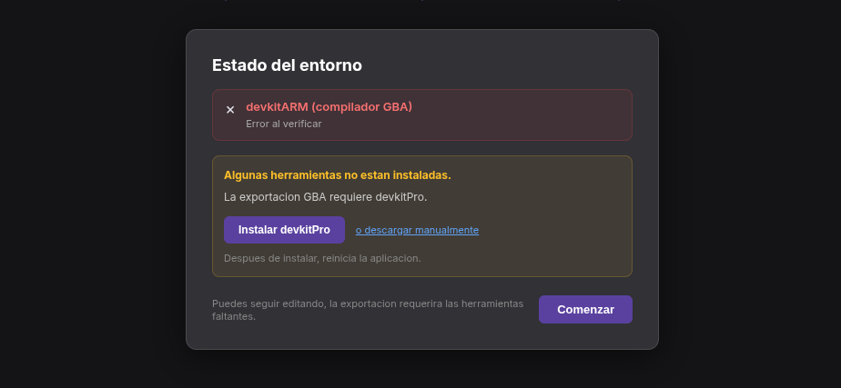

> Puedes seguir editando tu proyecto aunque falten herramientas; la compilación de la ROM requerirá que estén instaladas.

## 0.2. Pantalla inicial (Proyectos recientes)

Una vez tienes devkitARM instalado, la aplicación te lleva a la pantalla de **proyectos recientes**, donde se muestran hasta los **3 proyectos abiertos más recientemente**.

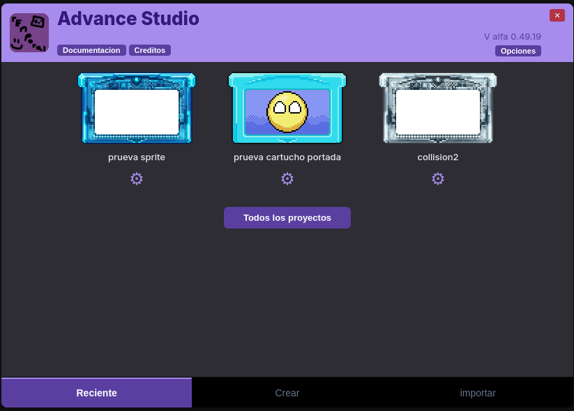

Cada tarjeta muestra el cartucho del proyecto y su nombre. Debajo de cada uno, el engranaje (⚙️) permite **editar el proyecto** (cambiar el cartucho, la portada o el nombre). Pulsar sobre el cartucho lo abre en el editor.

## 0.3. Barra superior y opciones

En la parte superior se encuentra la navegación principal:

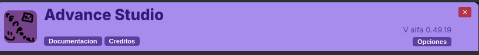

- **Documentación:** acceso a esta documentación.
- **Créditos:** pantalla de reconocimientos del proyecto.
- **Opciones:** menú de configuración de la aplicación.

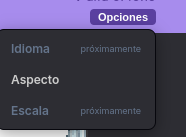

> **Nota:** en la versión actual, la opción **Aspecto** (tema visual) es la única operativa. **Idioma** y **Escala** están marcadas como “próximamente”.

## 0.4. Todos los proyectos

El botón **Todos los proyectos** abre la lista completa de proyectos creados e importados, para acceder a cualquiera de ellos sin depender de la pantalla de recientes.

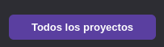

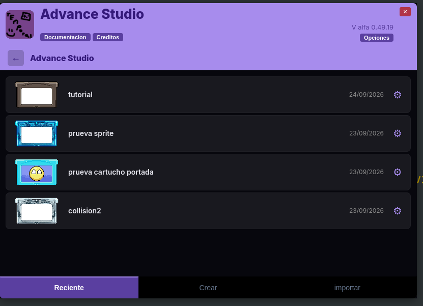

## 0.5. Crear un proyecto

En la pestaña **Crear** se configura un nuevo proyecto:

- **Nombre:** identificador del proyecto.
- **Ruta:** carpeta donde se guardará (usa el botón `...` para elegirla en el explorador).
- **Plantillas:** una de las plantillas base (Clásico, Color plano, Transparente).
- **Modificar cartucho:** personalizar el cartucho del proyecto.

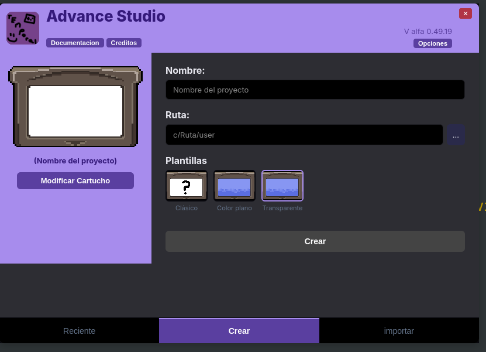

Pulsa **Crear** para generar el proyecto y entrar directamente al editor.

## 0.6. Importar un proyecto

En la pestaña **Importar** se puede vincular un proyecto ya creado anteriormente:

- Elige la **ruta** de la carpeta del proyecto existente.
- Ajusta el **nombre** si quieres.
- Puedes **modificar el cartucho** igual que al crear.

Esto te permite continuar trabajando en un proyecto sin necesidad de crearlo desde cero.

## 0.7. Personalización del cartucho

El botón **Modificar cartucho** (engranaje) abre la pantalla de personalización:

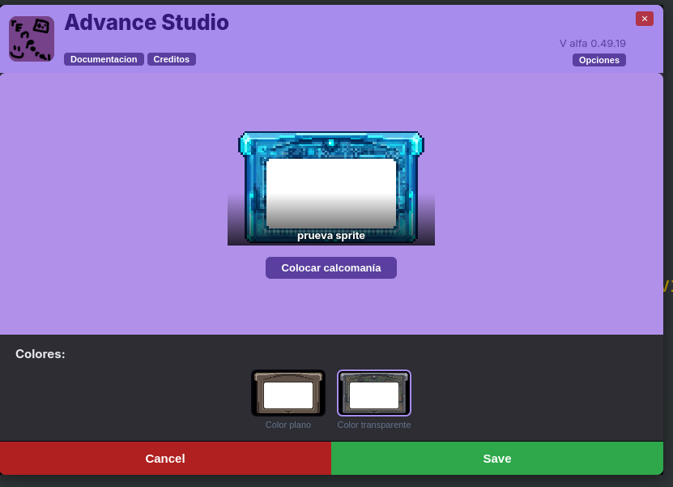

- **Tipo de cartucho:** *Color plano* o *Color transparente*.
- **Color:** uno de los 9 colores fijos (gris, blanco, rojo, verde, azul, morado, café, amarillo, negro) o un color personalizado con selector.

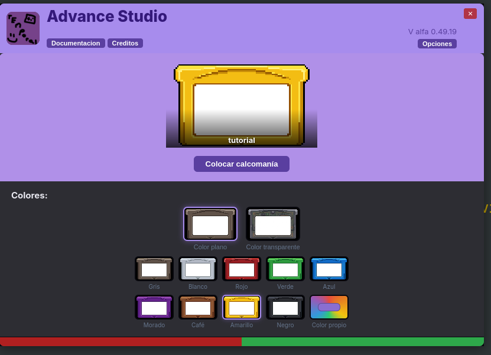

También puedes añadir una **portada (calcomanía)** personalizada:

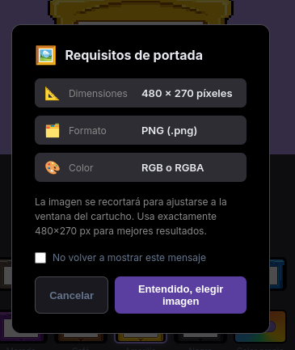

> **Requisito:** usa exactamente **480×270 px** para mejores resultados.

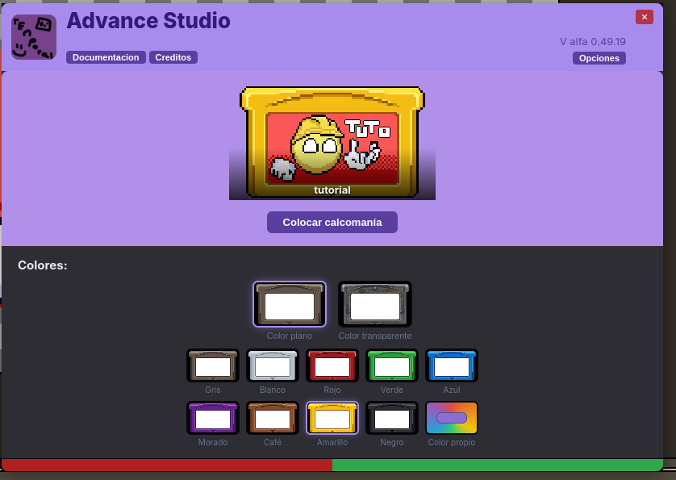

---

**Siguiente:** [01 — Interfaz de la aplicación](01-interfaz.md)